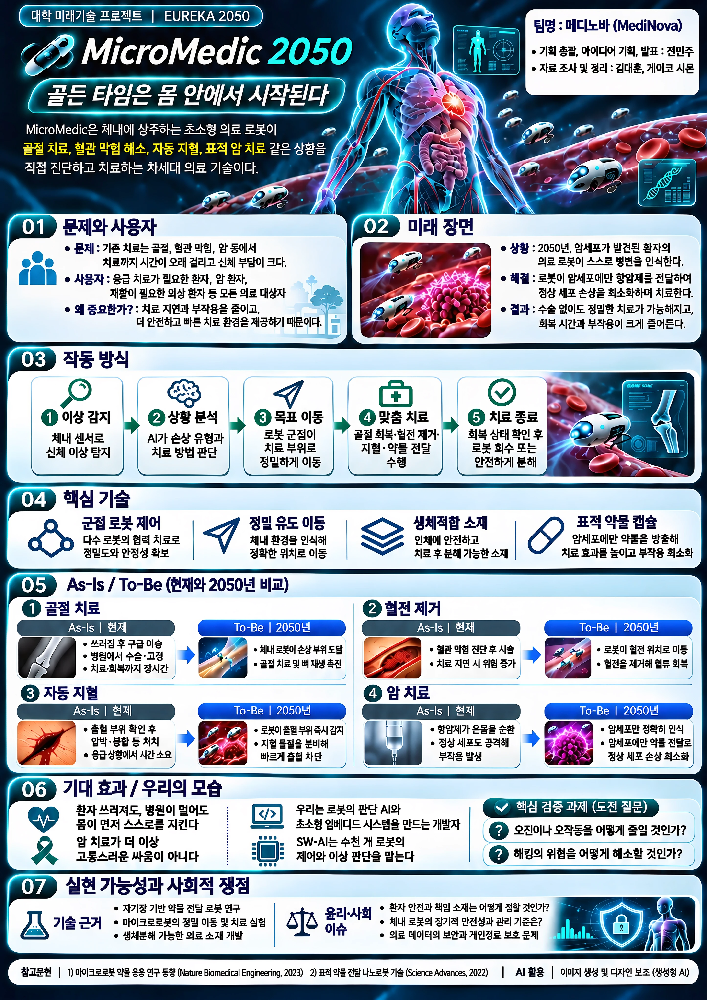

# Welcome to E26-SW01-01

## 🎯 팀 슬로건

> git commit -m "오늘도 한 줄"

## 🖼️ 팀 포스터

<div class="poster">
  <a href="poster.png">
    
  </a>
</div>

[🔍 포스터 원본 크게 보기](poster.png)

<p align="center" class="poster-caption"><sub>메디노바(MediNova) 팀, 「MicroMedic 2050: 골든타임은 몸 안에서 시작된다」(2026). 이미지 생성 및 디자인 보조: 생성형 AI</sub></p>

2050년, 혈관 속 초소형 의료 로봇이 골절·혈관 막힘·출혈·암을 스스로 찾아가 치료하는 미래를 상상했습니다.

> **김대훈**: 35년 전에는 인터넷도 없었을 텐데 과거에 상상했던 것들이 많이 이뤄진 게 신기했다. 달나라 여행도 멀지 않은 미래에 가능할 것 같아서, 미래 기술을 풍부하게 상상하는 것이 그 기술을 실제로 이뤄내는 발전의 초석이라는 생각이 들었다.
>
> **게이코 시몬**: 로봇청소기, 인터넷, 휴대전화처럼 실제로 실현된 것도 많지만, 자유롭게 우주를 비행하는 것처럼 아직 실현되지 않은 것도 있다. 그래도 인류가 계속 우주를 탐험하고 있으니 곧 현실이 될 것 같다.
>
> **전민주**: 포스터를 보니 zoom, 키오스크, 소형 TV, 핸드폰, 전기차, 태양열 같은 건 이미 구현됐고, 우주선이나 움직이는 도로 같은 건 아직 발전하지 못했다. 앞으로도 과학 기술은 다양한 발전 가능성이 있는 것 같다.

***

## 1️⃣ 팀원 소개

| **이름** | **전공** | **관심사** |
| --- | --- | --- |
| **전민주** | 소프트웨어전공 | 로봇, 자율주행, 영화 |
| **게이코 시몬** | 소프트웨어학부 |  스포츠, 공부, 게임하기|
| **김대훈** | 소프트웨어학부 | 인공지능, 게임 개발 |


### 팀 소개

국민대학교 소프트웨어융합대학 유레카프로젝트 E26-SW01-01 팀입니다. 전민주, 게이코 시몬, 김대훈 세 명으로 구성되어 있으며 모두 소프트웨어학부에 재학 중입니다. 로봇·자율주행, 인공지능, 게임 개발 등 각자 다른 분야에 관심이 있지만 인공지능이라는 공통 관심사로 뭉쳤습니다. "오늘도 한 줄"이라는 팀 슬로건처럼, 거창하지 않아도 매일 꾸준히 쌓아가는 한 학기를 만들어가고자 합니다.

***

## 2️⃣ 공통된 관심사 : 여행, 백엔드, 인공지능

***

## 3️⃣ 한학기 동안의 활동 내역 

- 기관/부서 인터뷰 ✔️  

- 현장 탐방 ✔️  

- 멘토링 ✔️  
  - 내 지도 교수 함께 만나기
  - 대학원 방문 및 선배 만나기

- 프로젝트 진행 ✔️  
  - 과거에 사람들이 상상한 미래

    -미션 2: 자율주행차 (김대훈)

      WHY – 과거의 문제의식
      사람이 직접 운전해야 하기 때문에 교통사고, 운전 피로, 교통약자의 이동 제한 등의 문제가 발생했다. 따라서 사람의 조작 없이 자동차가 스스로 목적지까지 안전하게 이동하는 모습을 상상하게 되었다.

      WHAT – 상상한 해결 방식
      자동차가 주변 도로와 차량, 사람, 신호등을 스스로 인식하고 상황에 맞게 판단하여 운전하는 기술을 상상했다. 사람이 운전하지 않아도 목적지를 입력하면 자동차가 알아서 이동하는 미래의 일상을 꿈꿨다.

      HOW – 현재의 구현 방식
      현재는 카메라, 레이더, 라이다 등의 센서와 GPS, 인공지능(AI), 자율주행 소프트웨어를 이용해 주변 환경을 인식하고 차량을 제어한다. 과거에는 완전히 스스로 운전하는 자동차를 상상했지만, 현재는 특정 조건에서만 자율주행이 가능하거나 운전자의 개입이 필요한 경우가 많다.

      NEXT – 남은 문제와 한계
      악천후나 복잡한 도로 상황에서의 판단, 돌발 상황 대응, 사고 발생 시 책임 문제 등이 아직 남아 있다. 또한 자율주행차가 수집하는 위치·영상 정보에 대한 개인정보 문제와 해킹 등 보안 문제도 해결해야 한다.

    -미션 2: 하늘을 나는 자동차 (전민주)

      WHY – 과거의 문제의식
      도로가 정체되고 먼 거리를 이동하는 데 시간이 오래 걸리는 문제가 있었다. 땅 위의 길에 갇히지 않고 하늘을 통해 목적지까지 자유롭게 이동하고 싶다는 상상에서 출발했다.

      WHAT – 상상한 해결 방식
      자동차와 비행기를 결합해 한 사람이 직접 소유하고 몰 수 있는 탈것을 상상했다. 도로에서는 자동차처럼 달리다가 필요할 때 날개를 펴고 하늘로 날아올라 이동하는 미래의 일상을 꿈꿨다. (1940년 헨리 포드의 예언, 이를 실제로 구현하려 한 Convair사의 ConvAirCar(1947)가 대표적인 과거 사례다.)

      HOW – 현재의 구현 방식
      현재는 Alef Model A처럼 도로 주행과 수직이착륙 비행이 모두 가능한 차량이 FAA 실험 카테고리 인증을 받았고 Xpeng AeroHT 같은 모듈형 비행차도 2026년 양산을 목표로 하고 있다. 다만 개인이 직접 소유하고 모는 방식보다는 Joby, Archer 같은 공유형 항공택시(eVTOL)가 2026년 여름 미국에서 먼저 상용화될 예정이라 상상했던 형태와는 다른 방식으로 현실화되는 중이다.

      NEXT – 남은 문제와 한계
      도로교통법과 항공 형식인증을 동시에 만족해야 하는 규제 문제, 개인 소유형 차량의 높은 가격(3억 원대)으로 인한 대중화의 어려움, 도심 상공의 교통관제 통합 문제, 사고 발생 시 책임 소재 문제 등이 아직 남아 있다.

    -미션 2: 로봇 청소기 (게이코 시몬)

      WHY – 과거의 문제의식
      과거에는 사람들이 직접 청소해야 했기 때문에 시간과 노력이 많이 필요했다. 그래서 사람들은 스스로 청소하는 로봇을 상상하게 되었다.

      WHAT – 상상한 해결 방식
      사람들은 사람이 직접 청소하지 않아도 로봇이 집 안을 돌아다니면서 바닥을 청소하는 미래를 상상했다. 또한 장애물을 피하고 자동으로 충전하는 로봇을 생각했다.

      HOW – 현재의 구현 방식
      현재는 센서와 인공지능을 이용해 집 안의 구조를 파악하고 장애물을 피하면서 청소하는 로봇 청소기가 있다. 또한 스마트폰으로 청소를 시작하거나 예약할 수 있다.

      NEXT – 남은 문제와 한계
      하지만 작은 장애물을 인식하지 못하거나 구석을 깨끗하게 청소하지 못하는 문제가 있다. 앞으로는 더 정확하게 장애물을 인식하고 청소 성능이 향상된 로봇이 필요하다.

  - AI가 만들어가는 세상
      - 미션 1 (김대훈)

        - 학교 공지사항 분산 문제
          - 사용자: 학교와 학과의 각종 공지를 확인해야 하는 학생
          - 상황: 공지사항이 학교 홈페이지, LMS, 이메일, 학과 홈페이지 등 여러 플랫폼에 나누어 전달됨
          - 문제: 학생이 여러 플랫폼을 반복해서 확인해야 하며 중요한 공지나 일정이 누락될 가능성이 있음
          - 기대효과: 공지사항을 한곳에서 통합하여 확인할 수 있다면 정보 탐색 시간을 줄이고 중요한 공지를 놓칠 가능성을 낮출 수 있음

      - 미션 2 (김대훈)

        - 아이디어: 대학 공지 통합 플랫폼
            
            - 필요성 (Why)

              학교의 공지사항이 학교 홈페이지, LMS, 학과 홈페이지 등 여러 플랫폼에 분산되어 있어 학생이 모든 정보를 직접 찾아 확인해야 한다. 이로 인해 장학금 신청, 수강 관련 일정, 과제 및 행사 등 중요한 정보를 놓칠 수 있다.
              따라서 여러 곳에 흩어진 공지를 한곳에서 확인할 수 있는 통합 시스템이 필요하다.
            
            - 새로움 (Novelty)

              단순히 공지를 한곳에 모으는 것에서 끝나지 않고, 사용자의 학과·학년·수강 과목 등에 따라 필요한 공지를 자동으로 분류하여 제공한다. 또한 수업, 장학, 취업, 행사, 학사 일정과 같이 공지를 카테고리별로 정리하고,
              중요한 공지나 마감이 임박한 공지를 우선적으로 보여주는 기능을 추가할 수 있다.
            
            - 실현 가능성 (How)

              학교 홈페이지와 학과 홈페이지의 공지사항을 API 또는 웹 크롤링을 통해 수집하고, LMS 등 연동 가능한 시스템의 데이터를 함께 가져와 하나의 데이터베이스에 저장한다. 이후 모바일 앱이나 웹사이트에서 공지를 통합하여 보여준다.
              공지 제목, 내용, 작성 날짜 등을 기반으로 카테고리를 자동 분류하고, 사용자가 관심 분야를 설정하여 맞춤형 알림을 받을 수 있도록 구현할 수 있다.
            
            - 위험 요소 (Risk)

              학교 시스템에서 API를 제공하지 않을 경우 공지사항 수집이 어렵거나 웹사이트 구조 변경으로 크롤링 기능에 문제가 생길 수 있다. 또한 공지가 잘못 분류되거나 수집이 지연될 경우 중요한 정보를 놓칠 가능성이 있다.
              개인정보와 수강 정보를 활용한다면 개인정보 보호와 보안 문제도 고려해야 한다.
            
            - 아이디어 선정 이유

              공지사항 분산 문제는 대부분의 대학생이 반복적으로 경험할 수 있는 문제이며, 중요한 정보를 놓칠 경우 수강신청, 장학금, 과제 및 학교 행사 등에 직접적인 불이익이 발생할 수 있다.
              또한 기존에 여러 플랫폼에 존재하는 정보를 하나의 서비스로 통합하고 사용자에게 필요한 정보만 선별하여 제공하는 방식으로 해결할 수 있어 실용성이 높다.
              웹이나 앱 형태로 구현할 수 있어 기술적으로도 구현 가능성이 높으며, 향후 개인 맞춤 알림이나 중요도 분류 등의 기능으로 확장할 수 있다는 점에서 이 아이디어를 선정하였다.

      - 미션 1 (전민주)

        - 학식 대기 현황 파악 문제
          - 사용자: 학교 식당(복지관, 법학관 등)을 이용하는 학생 및 교직원
          - 상황: 점심·저녁 시간대에 식당과 메뉴별 혼잡도가 크게 다르지만, 현재 대기 인원을 미리 알 수 있는 방법이 없음
          - 문제: 직접 식당에 가봐야 대기 상황을 알 수 있어, 긴 줄을 서거나 다른 식당으로 이동하며 시간을 낭비하게 되고 짧은 공강에는 식사를 포기하기도 함
          - 기대효과: 식당·메뉴별 대기 인원을 미리 확인할 수 있다면 덜 붐비는 식당과 메뉴를 선택해 대기 시간을 줄이고, 이용객이 분산되어 혼잡도도 완화될 수 있음

      - 미션 2 (전민주)

        - 아이디어: 키오스크 발권 데이터 기반 학식 대기 현황 서비스
            
            - 필요성 (Why)

              학교 식당은 특정 시간대에 이용객이 몰리지만, 학생들은 각 식당과 메뉴의 대기 상황을 미리 알 수 없어 직접 방문해야만 확인할 수 있다. 이로 인해 긴 줄에서 시간을 낭비하거나, 공강 시간이 짧은 경우 식사를 거르게 되는 일이 발생한다.
              따라서 복지관, 법학관 등 교내 식당의 메뉴별 대기 현황을 실시간으로 확인할 수 있는 시스템이 필요하다.
            
            - 새로움 (Novelty)

              별도의 카메라나 센서 없이, 식당에 이미 설치된 식권 키오스크의 발권 데이터를 활용해 대기 인원을 산출한다. 식권을 뽑을 때 해당 메뉴의 현재 대기자 수를 키오스크 화면과 식권에 함께 표시하고,
              같은 정보를 웹·앱에서도 "메뉴명 (대기 n명)" 형태로 실시간 제공한다. 또한 요일·시간대별 발권 데이터를 누적하여 한산한 시간대를 예측해 추천할 수 있다.
            
            - 실현 가능성 (How)

              키오스크에서 발권이 발생할 때마다 메뉴 정보와 발권 시각을 서버로 전송해 데이터베이스에 저장한다. 서버는 메뉴별로 최근 5분간의 발권 수를 집계하여 이를 현재 대기 인원으로 산출하고,
              키오스크 화면, 식권, 웹·모바일 앱에 실시간으로 표시한다. 별도의 하드웨어 설치나 배식 완료 처리 없이 발권 기록만으로 계산할 수 있어 기존 시스템에 간단히 연동할 수 있다.
            
            - 위험 요소 (Risk)

              키오스크 데이터를 활용하려면 학교와 식당 운영 업체, 키오스크 업체의 협조가 필요하며, 기존 시스템에서 데이터 연동을 지원하지 않을 수 있다.
              또한 최근 5분간의 발권 수만 반영하기 때문에 배식이 지연되어 줄이 길게 누적된 경우에는 실제 대기 인원보다 적게 표시될 수 있고, 단체로 발권하는 경우에는 일시적으로 많게 표시될 수 있다.
            
            - 아이디어 선정 이유

              학식 대기 문제는 교내 식당을 이용하는 대부분의 학생이 매일 겪는 문제이며, 특히 공강 시간이 짧은 학생에게는 식사 여부에 직접적인 영향을 준다.
              이미 존재하는 키오스크 발권 데이터를 활용하므로 추가 하드웨어 비용이 들지 않고, 영상 촬영이 없어 개인정보 문제에서도 자유롭다.
              발권 기록을 서버와 앱으로 연동하는 단순한 구조로 구현할 수 있어 실현 가능성이 높으며, 향후 혼잡도 예측, 메뉴별 품절 알림, 모바일 사전 주문 등으로 확장할 수 있다는 점에서 이 아이디어를 선정하였다.

      - 미션 1 (게이코 시몬)

        - 버스 정류장 탑승 대기 문제
          - 사용자: 버스를 이용하는 학생 및 일반 승객
          - 상황: 출퇴근·등교 시간에 많은 승객이 같은 버스를 타려고 정류장에 모이고, 버스가 도착하면 한꺼번에 탑승하려고 하여 줄이 길어지고 정류장이 혼잡해짐
          - 문제: 오랫동안 줄을 서야 하고, 버스가 만원이면 탑승하지 못한 채 다음 버스를 기다려야 하며, 먼저 타려고 경쟁하는 과정에서 불편함과 안전 문제가 발생할 수 있음
          - 기대효과: 가상 대기 번호로 탑승 순서를 관리하면 승객들이 질서 있게 탑승할 수 있고, 정류장의 혼잡과 탑승 과정의 불편을 줄일 수 있음

      - 미션 2 (게이코 시몬)

        - 아이디어: QR 코드를 활용한 버스 가상 대기 시스템
            
            - 필요성 (Why)

              출퇴근 시간과 등교 시간에는 많은 승객이 한꺼번에 버스에 탑승하려고 하기 때문에 정류장이 혼잡해지고 대기 시간이 길어진다. 특히 버스가 만원이면 탑승하지 못한 승객들은 다음 버스를 기다려야 한다.
              따라서 승객들의 탑승 순서를 관리하고 정류장의 혼잡을 줄일 수 있는 시스템이 필요하다.
            
            - 새로움 (Novelty)

              기존 버스 도착 정보 서비스와 달리, 이 시스템은 승객의 탑승 대기 순서를 직접 관리한다. 승객은 정류장의 QR 코드를 스캔하여 가상 대기 번호를 받고, 자신의 탑승 순서를 확인할 수 있다.
              버스가 도착하면 순서에 따라 탑승하고, 만원이면 다음 버스의 대기 순서로 자동 연결된다.
            
            - 실현 가능성 (How)

              정류장에 QR 코드를 설치하고, 승객이 스마트폰으로 스캔하면 가상 대기 번호를 발급한다. 시스템은 대기 순서와 탑승 여부를 관리하며, 버스에 탑승할 때 QR 코드로 확인한다.
              스마트폰이 없는 승객을 위해 정류장에 간단한 번호 발급 키오스크를 설치할 수도 있다. 우선 대학 셔틀버스나 특정 정류장에서 시범 운영할 수 있다.
            
            - 위험 요소 (Risk)

              스마트폰을 사용하기 어려운 승객을 위한 대체 방법이 필요하다. 또한 버스가 지연되거나 승객이 대기 순서에 맞춰 나타나지 않으면 순서가 변경될 수 있다.
              실제 버스 운행과 연동하려면 버스 운영 기관의 협조가 필요하며, 가상 대기 시스템만으로 버스의 물리적인 수용 인원을 늘릴 수는 없다.
            
            - 아이디어 선정 이유

              버스 정류장의 혼잡과 긴 대기 줄은 학생과 직장인이 자주 경험하는 문제이다.
              이 아이디어는 단순히 버스 도착 시간이나 혼잡도를 알려주는 것이 아니라, QR 코드를 이용해 실제 탑승 순서를 관리한다는 점에서 차별성이 있다.
              기존 스마트폰과 QR 코드 기술을 활용할 수 있으며, 대학 셔틀버스부터 적용한 후 일반 버스 정류장으로 확대할 수 있다는 점에서 실용성이 높다.

  - 그들이 만들어가는 세상
  - 우리가 상상한 미래

    ### 🩺 MicroMedic 2050

    **서비스 개요**
    > 2050년, 몸 안에 상주하는 초소형 의료 로봇이 건강 이상을 실시간으로 감지하고, AI의 판단에 따라 병변으로 이동하여 맞춤형 치료를 보조하는 차세대 정밀 의료 시스템.<br>
    > **"골든 타임은 몸 안에서 시작된다."**
    
    **👤 01. 핵심 사용자 (User)**
    > 응급 상황에서 신속한 치료가 필요한 환자, 혈관 질환 고위험군, 골절·외상 환자, 암 환자 등을 주요 사용자로 설정한다.<br>
    > 또한 환자의 상태를 지속적으로 관찰하고 치료 과정을 감독하는 의료진도 중요한 사용자에 해당한다.
    
    1) **페르소나 1 · 응급 외상 환자**: 사고로 골절이나 출혈이 발생한 A씨
       - 사고 직후 병원으로 이송되기까지 시간이 필요함
       - 출혈이나 조직 손상이 빠르게 악화될 가능성이 있음
       - **고민**: "병원에 도착하기 전에도 치료를 시작할 수는 없을까요?"
       - **주요 기능**: 손상 부위 감지, 국소 지혈 보조, 골절 회복 지원
    
    2) **페르소나 2 · 혈관 질환 고위험군**: 혈전 발생 위험이 높은 B씨
       - 혈관 내부의 이상을 조기에 발견하기 어려움
       - 혈관이 막히면 신속한 진단과 치료가 중요함
       - **고민**: "증상이 심해지기 전에 몸속의 이상을 발견할 수 없을까요?"
       - **주요 기능**: 혈관 상태 모니터링, 혈전 감지, 국소 치료 보조
    
    3) **페르소나 3 · 암 치료 환자**: 항암 치료를 받는 C씨
       - 전신 항암 치료 과정에서 정상 조직도 영향을 받을 수 있음
       - 치료 효과와 함께 부작용을 줄이는 것이 중요함
       - **고민**: "암 병변만 선택적으로 치료할 수 있다면 좋겠어요."
       - **주요 기능**: 병변 표적 인식, 국소 약물 전달
    
    4) **페르소나 4 · 의료진**: 응급 및 정밀 치료를 담당하는 D의사
       - 환자의 상태를 지속적으로 확인하고 치료 시점을 판단해야 함
       - 깊은 병변이나 미세한 조직에 접근하는 데 기술적 제약이 있음
       - **고민**: "환자의 상태를 실시간으로 파악하고 더 정밀하게 치료할 방법은 없을까요?"
       - **주요 기능**: AI 분석 결과 확인, 로봇 제어 감독, 치료 과정의 안전성 관리
    
    **📍 02. 사용 상황 (Situation)**
    1) **평상시 건강 관리**: 체내에 상주하는 의료 로봇이 신체 상태를 지속적으로 모니터링하는 상황
    2) **응급 출혈 발생**: 사고나 외상으로 출혈이 발생했지만 병원에서 처치받기까지 시간이 필요한 상황
    3) **골절 발생**: 손상된 뼈의 회복을 위해 수술·고정·재활 등의 치료가 필요한 상황
    4) **혈관 이상 발생**: 혈관 내부에 혈전이 형성되어 혈류가 방해받는 상황
    5) **암 치료 진행**: 암 병변을 치료하면서 정상 조직에 미치는 영향을 최소화해야 하는 상황
    6) **치료 후 관리**: 치료 결과를 확인하고 체내 의료 로봇을 안전하게 회수하거나 분해해야 하는 상황
    
    **😣 03. 현재의 불편 (Pain)**
    1) **응급 치료 지연**: 응급 환자는 병원 이송, 진단, 치료 준비에 시간이 필요하며, 그동안 상태가 악화될 수 있다.
    2) **정밀 접근의 어려움**: 혈관 내부나 깊은 조직에 있는 미세한 병변은 위치를 정확하게 파악하고 직접 치료하기 어렵다.
    3) **전신 약물의 부작용**: 약물이 혈액을 통해 전신에 전달되는 과정에서 치료 대상이 아닌 정상 조직에도 영향을 줄 수 있다.
    4) **골절 치료의 부담**: 골절의 정도에 따라 고정이나 수술이 필요하며, 회복과 재활에도 상당한 시간이 소요될 수 있다.
    5) **혈전 치료의 시간적 제약**: 혈전으로 혈관이 막히면 신속한 검사와 약물 또는 카테터 시술 등의 치료가 중요하다.
    6) **지속적인 체내 모니터링의 한계**: 현재는 체내 모든 부위의 미세한 이상을 상시 감지하고 해당 위치에서 즉시 치료하는 시스템이 보편화되어 있지 않다.
    
    **✨ 04. 미래의 변화 (Change)**
    1) **체내 상주형 의료 로봇**: 초소형 의료 로봇이 인체 내부에 머무르면서 신체의 이상 징후를 지속적으로 관찰한다.
    2) **AI 기반 이상 분석**: 센서가 수집한 정보를 AI가 분석하여 손상의 유형과 위험도, 필요한 치료 방식을 판단하도록 설계한다.
    3) **정밀 이동 및 치료**: 의료 로봇이 목표 병변까지 이동하여 필요한 부위에 선택적으로 개입한다.
    4) **골절 회복 지원**: 손상된 뼈 주변에 접근하여 조직 회복과 뼈 재생을 촉진하는 치료를 보조한다.
    5) **자동 지혈 및 혈전 치료**: 출혈 위치를 감지해 국소 지혈을 지원하거나, 혈전 부위에 접근하여 혈류 회복을 위한 치료를 보조한다.
    6) **표적 항암 치료**: 암 병변에 약물을 집중적으로 전달하여 정상 조직에 미치는 영향을 최소화하는 것을 목표로 한다.
    7) **치료 종료 및 안전 관리**: 치료 결과를 확인한 후 로봇을 회수하거나 생체적합성 소재를 이용해 안전하게 분해한다.
    8) **결과**: 환자는 병원에 도착하기 전부터 치료 지원을 받을 수 있고, 의료진은 더 빠르고 정밀한 치료를 수행할 수 있을 것으로 기대한다.
    
    **⭐ 05. 핵심 경험 (Value)**
    
    1) **🦴 골절 발생 · 뼈 재생 촉진 (페르소나 A)**
       - **As-Is**: 골절이 발생하면 병원으로 이송되어 진단을 받고, 손상 정도에 따라 고정·수술·재활 과정을 거친다.
       - **To-Be**: 체내 로봇이 손상 부위를 감지하고 해당 위치로 이동하여 뼈 재생과 조직 회복을 보조한다.
       - **기대 효과**: 치료 개시까지의 시간을 줄이고 회복을 촉진하는 정밀 치료가 가능해질 것으로 기대한다.
    
    2) **🩸 응급 출혈 · 자동 지혈 (페르소나 A)**
       - **As-Is**: 출혈 부위를 확인한 후 압박이나 봉합 등의 처치를 실시하며, 심한 출혈에서는 신속한 응급 대응이 중요하다.
       - **To-Be**: 의료 로봇이 체내 출혈 위치를 감지하고 해당 부위로 이동하여 국소적인 지혈을 보조한다.
       - **기대 효과**: 응급 상황에서 치료 지연을 줄이고 추가적인 조직 손상을 최소화하는 데 도움을 줄 수 있다.
    
    3) **🫀 혈관 이상 · 혈전 제거 (페르소나 B)**
       - **As-Is**: 혈전으로 혈류가 방해받으면 영상 검사 등으로 위치를 확인하고 약물이나 카테터 시술 등을 이용해 치료한다.
       - **To-Be**: 체내 로봇이 혈전 부위로 이동해 국소 치료를 지원하고 혈류 회복을 돕는다.
       - **기대 효과**: 병변에 대한 정밀 접근을 통해 혈전 치료의 신속성과 선택성을 높이는 것을 목표로 한다.
    
    4) **💊 암 치료 · 표적 약물 전달 (페르소나 C)**
       - **As-Is**: 전신 항암 치료에서는 약물이 정상 조직에도 영향을 주어 부작용이 발생할 수 있다.
       - **To-Be**: 의료 로봇이 암 병변을 표적으로 인식하고 필요한 위치에 약물을 집중적으로 전달한다.
       - **기대 효과**: 정상 조직의 손상을 줄이고 치료 효율을 높이는 개인 맞춤형 정밀 의료를 기대할 수 있다.
    
    > MicroMedic은 병원이 아닌 몸속에서부터 치료를 시작한다는 개념을 바탕으로, 환자의 상태를 감지하고 목표 부위로 이동해 국소 치료를 보조하는 2050년의 미래 의료 시스템이다.<br>
    > 위 사례는 현재 연구 중인 마이크로로봇 기술을 바탕으로 구상한 미래 시나리오이며, 실제 임상에서 구현되거나 상용화된 치료 방식은 아니다.
    
    **🔧 06. 필요한 기술 (Tech)**
    1) **체내 생체 센싱**: 신체 내부의 이상 징후를 감지하고 분석에 필요한 정보를 수집하는 초소형 센서 기술
    2) **의료 AI 분석 시스템**: 체내 센서 데이터를 바탕으로 병변의 종류, 위치, 위험도 및 치료 필요성을 분석하는 기술
    3) **마이크로로봇 군집 제어**: 여러 대의 초소형 로봇이 협력하여 움직이고 치료를 수행하도록 제어하는 기술
    4) **정밀 위치 추적 및 유도**: 자기장 등의 외부 제어 기술을 이용하여 로봇을 목표 부위까지 정밀하게 이동시키는 기술
    5) **생체적합성 소재**: 인체 내부에서 부작용을 최소화하고, 임무 종료 후 회수하거나 분해할 수 있도록 설계된 소재 기술
    6) **표적 약물 전달 시스템**: 약물 캡슐을 이용해 치료가 필요한 병변에 약물을 선택적으로 전달하는 기술
    7) **조직 재생 및 국소 치료 기술**: 손상된 조직의 회복을 지원하고 혈전이나 출혈 부위에 선택적으로 개입하기 위한 치료 기술
    8) **실시간 통신 및 모니터링**: 체내 로봇의 상태를 확인하고 의료진이 치료 과정을 감독할 수 있도록 지원하는 통신·제어 기술
    9) **의료 시스템 보안**: 로봇 제어 명령과 환자의 의료정보를 보호하기 위한 인증, 암호화, 접근 통제 등의 기술
    
    **⚠️ 07. 남은 위험 (Risk)**
    1) **AI 오진 및 오작동**: AI가 정상 조직을 병변으로 잘못 판단하거나 로봇이 잘못된 위치에서 작동하면 인체에 심각한 손상을 줄 수 있다.
    2) **사이버 보안 위협**: 외부에서 로봇 제어 시스템에 침입하거나 치료 명령을 변조할 경우 환자의 안전이 위협받을 수 있다.
    3) **생체적합성 및 장기 안전성**: 체내에 장기간 상주하는 로봇이 면역 반응이나 독성을 유발하지 않는지 충분한 검증이 필요하다.
    4) **정밀 제어의 어려움**: 혈류와 조직의 복잡한 환경에서 초소형 로봇의 위치와 이동 방향을 정확하게 제어하는 것은 기술적으로 어렵다.
    5) **의료진의 통제와 책임**: AI가 치료 판단을 지원하더라도 최종적인 의료적 책임과 감독 권한을 어떻게 유지할지 정해야 한다.
    6) **개인정보 보호**: 지속적으로 수집되는 체내 생체 정보와 진료 정보의 유출 및 오남용을 방지해야 한다.
    7) **의료 접근성 격차**: 새로운 의료기술의 개발·운용 비용이 높아지면 환자의 경제적 상황에 따라 이용 가능 여부가 달라질 수 있다.
    
    **핵심 검증 과제**
    1) **오진·오작동을 어떻게 줄일 것인가?**
       - 다양한 상황에서 의료 AI의 정확도와 안전성을 검증한다.
       - 로봇의 이상 행동을 감지하고 비상 중단 기능을 마련한다.
       - 의료진이 치료 과정을 실시간으로 감독하고 필요한 경우 개입할 수 있도록 한다.
    
    2) **해킹 위협을 어떻게 해소할 것인가?**
       - 의료 로봇과 외부 시스템 사이의 통신을 암호화한다.
       - 인증 및 접근 통제를 통해 허가되지 않은 제어 명령을 차단한다.
       - 안전한 소프트웨어 업데이트와 비정상 명령 탐지 체계를 마련한다.
    
    **해결 방향**
    > 의료 AI에 대한 반복적인 검증과 의료진의 최종 감독을 전제로 체내 로봇을 운영한다. 또한 비상 중단, 안전한 로봇 회수·분해, 데이터 암호화, 접근 통제 등의 보호 체계를 갖추어 환자의 신체 안전과 의료정보 보호를 최우선으로 고려해야 한다.
    
    **🔍 08. 기술 벤치마킹 (Benchmarking)**
    
    **벤치마킹 목적**
    > MicroMedic 2050의 기술적 실현 가능성을 검토하기 위해 현재 연구되고 있는 마이크로로봇, 정밀 제어, 표적 약물 전달 및 생체적합성 소재 기술을 살펴보았다.<br>
    > 현재 연구 단계에 있는 기술들이 앞으로 어떻게 발전하여 체내 상주형 의료 로봇 시스템으로 연결될 수 있을지 검토한다.
    
    **주요 연구 분야 및 기술 비교**
    1) **자기장 기반 마이크로로봇**: 외부 자기장으로 초소형 로봇의 이동을 유도하는 연구 → 체내 로봇의 위치 및 이동 방향 제어
    2) **마이크로로봇 정밀 이동 기술**: 유체 환경과 미세 구조에서 로봇을 조종하고 추적하는 연구 → 혈관과 조직 내부의 목표 병변으로 이동
    3) **표적 약물 전달 기술**: 치료 대상에 약물을 집중적으로 전달하려는 연구 → 암 병변에 선택적인 약물 전달
    4) **생체적합성·생분해성 소재**: 인체에 적용 가능한 소재와 분해 가능한 구조에 관한 연구 → 치료 종료 후 로봇의 안전한 회수 또는 분해
    5) **조직 재생 기술**: 손상된 조직의 재생을 촉진하기 위한 생체재료 및 미세 치료 기술 연구 → 골절 회복 및 조직 재생 보조
    
    **기술별 벤치마킹 분석**
    
    1) **🧲 자기장 기반 마이크로로봇**
       - **현재 기술**: 외부 자기장을 이용해 초소형 로봇이나 자성 구조물의 이동을 유도하는 연구가 진행되고 있다.
       - **MicroMedic 적용**: 체내 의료 로봇이 혈관이나 조직 내부의 목표 부위까지 이동할 수 있도록 정밀 유도 시스템에 활용한다.
       - **한계 및 설계 방향**: 복잡한 체내 환경에서 정확한 위치 추적과 이동 제어가 필요하며, 안전한 외부 제어 방식에 대한 검증이 요구된다.
    
    2) **🎯 마이크로로봇 정밀 이동 및 군집 제어**
       - **현재 기술**: 미세 환경에서 로봇의 이동을 제어하거나 여러 초소형 구조물을 협력적으로 움직이는 연구가 진행되고 있다.
       - **MicroMedic 적용**: 여러 로봇이 역할을 분담하여 이상을 감지하고, 목표 부위에 이동하여 치료를 보조하도록 설계한다.
       - **한계 및 설계 방향**: 로봇 간 간섭, 위치 추적 오차, 혈류에 의한 이동 방해 등을 줄이는 기술이 필요하다.
    
    3) **💊 표적 약물 전달 기술**
       - **현재 기술**: 약물을 특정 조직이나 병변에 집중적으로 전달하여 치료 효율을 높이려는 연구가 진행되고 있다.
       - **MicroMedic 적용**: 체내 로봇이 약물 캡슐을 운반해 암 병변에 선택적으로 약물을 방출하도록 구상한다.
       - **기대 효과**: 정상 조직의 약물 노출을 줄이고 보다 정밀한 치료를 지원할 가능성이 있다.
    
    4) **🧬 생체적합성 및 생분해성 소재**
       - **현재 기술**: 인체와의 적합성을 고려한 의료용 소재 및 일정 조건에서 분해되는 생체재료에 대한 연구가 진행되고 있다.
       - **MicroMedic 적용**: 로봇이 치료 임무를 마친 후 안전하게 회수되거나 분해될 수 있도록 소재와 구조를 설계한다.
       - **한계 및 설계 방향**: 장기간 체내 상주 시의 안정성과 분해 생성물의 안전성을 검증해야 한다.
    
    5) **🦴 조직 재생 및 국소 치료**
       - **현재 기술**: 손상된 뼈와 조직의 회복을 촉진하는 재생 의료 및 약물 전달 기술이 연구되고 있다.
       - **MicroMedic 적용**: 로봇이 골절 부위에 접근해 재생을 위한 물질을 전달하거나 조직 회복 과정을 보조하도록 구상한다.
       - **한계 및 설계 방향**: 실제 체내 환경에서 치료 효과를 확인하고 정상 조직에 대한 영향을 최소화해야 한다.
    
    **기존 기술과의 차별성**
    > 현재의 연구들은 마이크로로봇의 이동, 약물 전달, 생체재료 및 조직 재생 등의 개별 기술을 중심으로 진행되고 있다. MicroMedic 2050은 이러한 기술을 하나의 시스템으로 연결하고, AI 기반 이상 감지부터 치료 종료까지 이어지는 체내 정밀 의료 시스템을 구상한다.
    
    1) **상시 모니터링**: 체내에 상주하는 로봇이 신체 상태를 지속적으로 관찰하고 이상 징후를 감지한다.
    2) **AI 기반 판단**: 체내 센서 정보를 분석하여 치료가 필요한 위치와 상황을 파악한다.
    3) **정밀 국소 치료**: 로봇이 목표 부위로 이동하여 필요한 치료를 선택적으로 수행한다.
    4) **다양한 의료 분야 적용**: 골절 회복, 자동 지혈, 혈전 제거, 표적 암 치료 등 여러 치료 분야로 확장한다.
    5) **치료 전 과정 관리**: 이상 감지부터 치료, 상태 확인, 로봇 회수 또는 분해까지 하나의 체계로 연결한다.
    
    **기술적 실현 가능성과 한계**
    1) **현재 연구되고 있는 기술**: 자기장 기반 마이크로로봇, 정밀 이동 제어, 표적 약물 전달, 생체적합성 소재 등은 관련 연구가 진행되고 있다.
    2) **추가 검증이 필요한 기술**: 인체 내부에서 로봇이 장기간 상주하며 스스로 건강 이상을 감지하고 다양한 치료를 수행하는 통합 시스템은 추가적인 연구와 임상적 검증이 필요하다.
    3) **정확성과 신뢰성**: 의료 AI의 판단 오류와 로봇의 위치 제어 오차는 환자의 안전에 직접적인 영향을 줄 수 있다.
    4) **사이버 보안**: 외부에서 의료 로봇을 제어하는 시스템은 무단 접근과 명령 변조를 방지해야 한다.
    5) **생체 안전성**: 장기간 체내 상주하는 로봇의 면역 반응, 독성, 분해 및 회수 문제를 검증해야 한다.
    6) **대응 방안**: 의료진 감독, AI의 반복 검증, 비상 중단 기능, 암호화된 통신, 안전한 회수 및 분해 체계를 단계적으로 연구해야 한다.
    
    **벤치마킹 결론**
    > 이번 벤치마킹을 통해 MicroMedic 2050의 핵심 기능을 구성하는 기술들이 각각 독립적인 연구 분야로 발전하고 있음을 확인할 수 있다.<br>
    > MicroMedic의 핵심적인 차별성은 이러한 기술들을 하나의 체내 의료 시스템으로 통합하여 건강 이상을 감지하고, AI가 상황을 분석하며, 의료 로봇이 병변에 접근해 정밀 치료를 보조하도록 구상했다는 점이다.<br>
    > 2050년에는 기술의 발전과 안전성 검증을 통해 병원에 도착한 뒤에만 치료가 시작되는 방식에서, 몸속에서부터 치료를 지원하는 새로운 의료 환경으로 발전할 가능성을 제안한다.
    
    **📚 참고 문헌 및 자료**

    1. Landers, F. C. et al. (2025). *Clinically ready magnetic microrobots for targeted therapies*. **Science**. https://doi.org/10.1126/science.adx1708
    2. Ding, Z. et al. (2025). *Janus hydrogel microrobots with bioactive ions for the regeneration of tendon-bone interface*. **Nature Communications, 16**, 2189. https://www.nature.com/articles/s41467-025-57499-x
    3. Wang, F. et al. (2026). *Optoacoustic-Guided Magnetic Microrobot Platform for Precision Drug Delivery*. **Advanced Materials, 38**. https://doi.org/10.1002/adma.202511870
    
    **🎤 발표 자료**
    > [MicroMedic 2050 HTML 발표 자료 보기](https://kookmin-sw.github.io/E26-SW01-01/presentation/)
    
    **프로젝트의 최종 목표**
    > **"골든 타임은 몸 안에서 시작된다."**<br>
    > MicroMedic 2050은 체내 상주형 의료 로봇과 AI 기술을 결합하여 치료의 시간적·공간적 한계를 줄이고, 더 빠르고 정밀하며 안전한 의료 서비스를 구현하는 미래를 제안한다.
  

  - 우리가 그리는 미래 그리고 나

- 각오와 소감 나누기 ✔️  


<!-- 활동 사진 추가 예시 -->


***

## 4️⃣ 인상 깊은 활동

- 활동명 – 활동에 대한 간단한 설명과 배운 점을 작성  
- 예: 멘토링에서 실리콘밸리 현업 경험을 들을 수 있어 진로 방향 설정에 큰 도움이 되었다.  

***

## 5️⃣ 특별히 알아보고 싶은 것
- 예: 현장실습 제도
- 예: 학부 졸업 인증 조건
- 예: 성취기반평가
- 예: 졸업 후 진로(대학원/취업)

***

## 6️⃣ 활동을 마친 소감

🔗학번 이름  
> "소감 내용을 여기에 작성합니다."

🔗학번 이름  
> "소감 내용을 여기에 작성합니다."

🔗학번 이름  
> "소감 내용을 여기에 작성합니다."

🔗학번 이름  
> "소감 내용을 여기에 작성합니다."

🔗학번 이름  
> "소감 내용을 여기에 작성합니다."


## Markdown을 사용하여 내용꾸미기를 익히세요.

Markdown은 작문을 스타일링하기위한 가볍고 사용하기 쉬운 구문입니다. 여기에는 다음을위한 규칙이 포함됩니다.

```markdown
Syntax highlighted code block

# Header 1
## Header 2
### Header 3

- Bulleted
- List

1. Numbered
2. List

**Bold** and _Italic_ and `Code` text

[Link](url) and 
```

자세한 내용은 [GitHub Flavored Markdown](https://guides.github.com/features/mastering-markdown/).

### Support or Contact

readme 파일 생성에 추가적인 도움이 필요하면 [도움말](https://help.github.com/articles/about-readmes/) 이나 [contact support](https://github.com/contact) 을 이용하세요.
